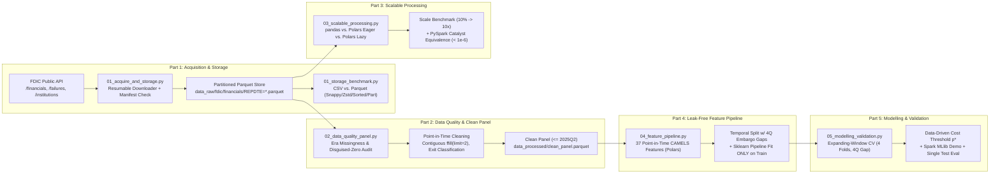

# A Big-Data Pipeline for Bank Failure Early Warning (FDIC 1984Q1–2026Q2)

**Course:** BFT65B – Big Data Analytics in Finance (National Economics University)  
**Project Type:** Final Examination – Individual Research Report & Reproducible Data Engineering Pipeline  
**Scope:** Quarterly FDIC Call Reports (`1984Q1`–`2026Q2`, 170 quarters, `1,682,616` bank-quarter rows, `24,064` distinct institutions), complete `Failures` (`4,117` records) and `Institutions` (`27,835` records) tables.

---

## 1. Executive Summary & Key Metadata

| Item | Specification / Empirical Result |
| :--- | :--- |
| **Data Source & Acquisition** | Public FDIC BankFind Suite REST API (`https://api.fdic.gov/banks`), resumable quarterly downloader (`src/01_acquire_and_storage.py`) |
| **Raw Panel Coverage** | `1984Q1` (`19840331`) $\rightarrow$ `2026Q2` (`20260630`) — **170 quarters**, **1,682,616 rows $\times$ 36 columns**, **0 duplicates** |
| **Clean Modeling Panel ($\le$ 2025Q2)** | `1984Q1` $\rightarrow$ `2025Q2` (`20250630`) — **166 quarters**, **1,659,479 rows**, **24,025 banks** (**3,209** failed banks; **12,294** positive $y_{i,q}=1$ observations, base rate **0.741%**) |
| **Target Label Definition** | $y_{i,q} = \mathbb{1}\{\text{bank } i \text{ fails in } (q, q+4\text{ quarters}]\}$; mergers and voluntary exits are coded as $y_{i,q} = 0$; post-failure rows (`REPDTE >= FAILDATE`) are removed |
| **Development Period** | `1984Q1`–`2008Q4` (**1,258,781 rows**, **2,828 failed banks**): split into **Train** (`1984Q1–2006Q4`, 2,651 failed banks), **Inner Embargo Gap** (`2007Q1–2007Q4`, 4 quarters purged), and **Validation** (`2008Q1–2008Q4`, 176 failed banks) |
| **Outer Embargo / Purging Gap** | `2009Q1`–`2009Q4` (**4 full quarters**, `32,838` rows purged) — strictly separates Development and Test so 4-quarter forward labels from `2008Q4` never overlap with the Test period |
| **Hold-Out Test Period** | `2010Q1`–`2025Q2` (**62 quarters**, **367,860 rows**, **341 failed banks** $\ge 50$ required, **1,109** positive $y_{i,q}=1$ rows) — evaluated **once** |
| **Best Early-Warning Model** | **LightGBM (37 Point-in-Time CAMELS Features)**: Test **PR-AUC = 0.6478** (vs. `0.5527` Baseline), **ROC-AUC = 0.9880**, **Brier = 0.00165**, **Recall @ Top 1% = 69.07%**, **Recall @ Top 5% = 95.04%**, **Supervisory Cost Savings = 68.37%** |

---

## 2. Pipeline Architecture



### Strict Anti-Leakage Architecture (`RULES.md`)
To comply strictly with the examination **Leakage Gate**, this pipeline enforces four engineering invariants:
1. **Point-in-Time Feature Construction ($\le q$):** Every financial ratio, lag (`shift(1)`, `shift(4)`), 4-quarter growth rate, and backward rolling statistic (`rolling_mean(4)`, `rolling_std(4)`) is computed strictly within each bank's chronological history (`over("CERT")` ordered by `REPDTE`). Backward-filling (`bfill`) is **never** used.
2. **Disguised Structural Missingness Recoding:** Prior to Basel I (`1990Q1`) and under the 2020 Community Bank Leverage Ratio (CBLR) exemption, the FDIC API encodes unreported `RBCRWAJ` and `RBC1AAJ` as `0.0` rather than `NULL`. Our audit identifies and recodes these structural zeros (when `EQ != 0`) to `NaN` so models are never trained on fake 0% capital ratios.
3. **Train-Only Preprocessing Fit:** Outlier clipping bounds (`InfAndOutlierClipper` at `[0.5%, 99.5%]` quantiles), median imputation (`SimpleImputer(strategy='median')`), and standardization (`StandardScaler`) are wrapped inside a `sklearn.pipeline.Pipeline` that is `.fit()` **exclusively on the Training split** (`1984Q1–2006Q4`, or each CV fold's training window).
4. **4-Quarter Purging / Embargo Gaps:** Because $y_{i,q}$ looks ahead 4 quarters $(q, q+4]$, a **4-quarter embargo gap** is purged between Train and Validation (`2007Q1–2007Q4`), across every Expanding-Window CV fold, and between Development and Test (`2009Q1–2009Q4`).

---

## 3. Repository Structure

```text
Final_report/
├── README.md                          # Project documentation & reproduction guide
├── RULES.md                           # Golden rules on zero look-ahead bias & leakage gate
├── requirements.txt                   # Pinned Python dependencies for exact reproducibility
├── .gitignore                         # Blocks data_raw/, data_processed/, *.parquet, *.csv
├── fdic_download_starter.py           # Course starter script reference
├── run_pipeline.py                    # Master single-command end-to-end orchestrator
├── src/
│   ├── 01_acquire_and_storage.py      # Part 1: Resumable FDIC downloader & completeness check
│   ├── 01_storage_benchmark.py        # Part 1: Storage layout benchmark (CSV vs Parquet variants)
│   ├── 02_data_quality_panel.py       # Part 2: Automated data quality audit & clean panel builder
│   ├── 03_scalable_processing.py      # Part 3: Polars vs. pandas scale benchmark & PySpark check
│   ├── 04_feature_pipeline.py         # Part 4: 37 CAMELS point-in-time features & sklearn Pipeline
│   └── 05_modelling_validation.py     # Part 5: Expanding-Window CV, MLlib, cost p*, single Test eval
└── outputs/
    ├── tables/
    │   ├── part1_storage_benchmark.csv    # Disk size, write, full-scan & selective-read timings
    │   ├── part2_data_quality_report.csv  # Column-by-era missingness, anomalies & gap audit
    │   ├── part2_panel_summary.csv        # Yearly active banks, failures, mergers & y=1 counts
    │   ├── part3_polars_vs_pandas.csv     # Wall time & peak RAM across 10%, 50%, 100%, 5x, 10x
    │   ├── part3_polars_plan.txt          # Polars optimized vs unoptimized query execution plan
    │   ├── part3_spark_plan.txt           # PySpark Catalyst plan & < 1e-6 numerical verification
    │   ├── part4_split_summary.csv        # Row & failure counts across Train, Gaps, Val, Test
    │   ├── part4_feature_dictionary.csv   # 37 CAMELS features, formulas, Train medians & correlations
    │   ├── part5_cv_results.csv           # 4-fold Expanding-Window Time-Series CV results
    │   └── part5_model_comparison.csv     # Validation & Single Hold-Out Test evaluation metrics
    └── figures/
        ├── part1_storage_comparison.png   # Storage benchmark comparison bar charts
        ├── part2_failures_timeline.png    # Historical US bank failures timeline (S&L, GFC, 2023)
        ├── part3_benchmark.png            # Polars vs. pandas runtime, peak RAM & speedup curves
        ├── part4_split_and_features.png   # Temporal split timeline & top CAMELS correlations
        ├── part5_pr_roc_curves.png        # Validation & Test PR curves + Supervisory Recall@Top-K%
        ├── part5_cost_threshold.png       # Data-driven supervisory cost vs. probability threshold p*
        └── part5_feature_importance.png   # Top 20 CAMELS features by permutation importance
```

*(Note: `data_raw/` and `data_processed/` are generated locally by the pipeline and strictly excluded from Git via `.gitignore`.)*

---

## 4. Environment Setup & End-to-End Reproduction

### 4.1 Installation
Requires **Python 3.11+** (tested on Python 3.13 on Windows). Install the exact pinned dependencies from `requirements.txt`:

```bash
python -m venv .venv
# Windows PowerShell:
.\.venv\Scripts\Activate.ps1
# Linux / macOS:
# source .venv/bin/activate

pip install -r requirements.txt
```

*(For PySpark local execution in Part 3 and Part 5, if `JAVA_HOME` is not already configured on the machine, the scripts automatically provision a portable OpenJDK 17 into `~/.jdk` via `install-jdk`.)*

### 4.2 Single-Command End-to-End Execution
To run the entire pipeline from data acquisition/verification through final hold-out test evaluation and verify all 17 output artifacts:

```bash
python run_pipeline.py
```

Useful flags for `run_pipeline.py`:
- **Quick 4-quarter acquisition test (`2023Q1–2023Q4`):**
  ```bash
  python run_pipeline.py --quick-acquire
  ```
- **Verify all generated output tables and figures:**
  ```bash
  python run_pipeline.py --verify-only
  ```

### 4.3 Running Individual Pipeline Stages
Each stage can also be executed independently from the repository root:

```bash
# Part 1: Download FDIC data (resumable; skips already-complete quarters) & run storage benchmark
python src/01_acquire_and_storage.py
python src/01_storage_benchmark.py

# Part 2: Run automated data quality audit & construct point-in-time clean panel (<= 2025Q2)
python src/02_data_quality_panel.py

# Part 3: Benchmark pandas vs. Polars (10% to 10x) & verify PySpark equivalence (< 1e-6)
python src/03_scalable_processing.py

# Part 4: Build 37 CAMELS point-in-time features, temporal split & Train-only sklearn Pipeline
python src/04_feature_pipeline.py

# Part 5: Run Expanding-Window CV, Spark MLlib demo, cost threshold optimization & single Test eval
python src/05_modelling_validation.py
```

---

## 5. Summary of Answers to Core Research Questions (Q1–Q3)

1. **Q1 (Storage & When a Spark Cluster is Justified):**
   - Storing the 42-year panel (`1.68M` rows $\times$ `36` columns) in **Parquet + Zstd sorted by `(REPDTE, CERT)`** reduces disk footprint by **64.5%** (`150.8 MB` vs. `425.0 MB` raw CSV), speeds up full-table scans by **31$\times$** (`0.46s` vs. `14.30s`), and accelerates selective single-quarter/column reads by **445$\times$** (`0.010s` vs. `4.474s`) via column projection and row-group min/max predicate pushdown.
   - On a single laptop, **Polars Lazy** executes our complex multi-join, bank-level window (`shift(1)`, `shift(4)`, `rolling_mean(4)`, `rolling_std(4)`), and state-quarter aggregation pipeline in **0.71 seconds** on the 100% dataset (`1.68M` rows) and **7.87 seconds** at **10$\times$ scale (`16.8M` rows, `2.3 GB` RAM)** — **12.4$\times$ faster** and using **46% less RAM** than `pandas` (`97.27s`, `4.3 GB` RAM). By contrast, local **PySpark** takes **25.08 seconds** on the 100% dataset due to JVM initialization and local shuffle overhead (`Exchange hashpartitioning`). A multi-node **Spark cluster** is justified only when dataset sizes exceed single-node memory ($> 50\text{–}100\text{ GB}$, e.g., loan-level credit registry or daily interbank payment panels with $> 500\text{M}$ rows).

2. **Q2 (Data Quality Problems & Leak-Free Handling):**
   - Our automated audit (`part2_data_quality_report.csv`) uncovers: (i) **disguised zero-coded structural missingness** in `RBCRWAJ` (`100%` coded as `0.0` in `1984–1989` pre-Basel I and `37.1%` in `2020–2026` under the CBLR exemption) and `RBC1AAJ` (`12.8%` in `1984–1992`), which we recode to `NaN`; (ii) **era-specific reporting onset** (`P3ASSET` 100% missing in `1984–2000`, becoming public in `2001Q1`); (iii) **742 impossible negative stock values** (`CHBAL < 0`, `LNATRES < 0`, etc.); (iv) **extreme ratio outliers** (`|ROA| > 50`, `|ROE| > 500`); and (v) **16,386 merged/voluntary exits vs. 3,243 true failures**.
   - To eliminate look-ahead bias, short gaps ($\le 2$ consecutive quarters) are repaired strictly via causal within-bank forward-fill (`ffill(limit=2)`), while cross-sectional median imputation, outlier clipping (`[0.5%, 99.5%]`), and scaling are fitted **exclusively on the Training set**.

3. **Q3 (Supporting an Honestly Validated Early-Warning Model & Vietnam Adaptation):**
   - Evaluated **once** on the post-embargo hold-out Test set (`2010Q1–2025Q2`, `367,860` rows, `341` failed banks), our **LightGBM (CAMELS)** model achieves **PR-AUC = 0.6478**, **ROC-AUC = 0.9880**, **Recall @ Top 1% = 69.07%**, and **Recall @ Top 5% = 95.04%**, reducing expected supervisory cost by **68.37%** at the validation-calibrated threshold $p^*$.
   - **Adaptation for the State Bank of Vietnam (SBV):** Because formal bank liquidations in Vietnam are historically zero (distressed banks are resolved via mandatory restructuring, zero-dong acquisitions, or special control — *kiểm soát đặc biệt*), deploying this pipeline at SBV requires redefining $y_{i,q}$ to predict entry into **SBV Special Control / Mandatory Transfer**, incorporating Credit Information Center (CIC) cross-debt and related-party real-estate concentration features, and adjusting for VAS vs. IFRS-9 loan classification lags.

---

## 6. Academic Integrity & Citations

### 6.1 Data Sources
- **Federal Deposit Insurance Corporation (FDIC):** *BankFind Suite Public REST API & Call Report Data Dictionary (`risview_properties.yaml`)*. Available at: https://api.fdic.gov/banks/docs/ (Accessed November 2026).

### 6.2 Domain & Methodology Literature
- **CAMELS Supervisory Rating System:** Federal Financial Institutions Examination Council (FFIEC), *Uniform Financial Institutions Rating System (UFIRS)*, Federal Register Vol. 61, No. 245 (1996).
- **Bank Failure Early-Warning Models & Texas Ratio:**
  - Cole, R. A., & White, L. J. (2012). *Déjà Vu All Over Again: The Causes of U.S. Commercial Bank Failures This Time Around*. Journal of Financial Services Research, 42(1), 5–29.
  - Wheelock, D. C., & Wilson, P. W. (2000). *Why Do Banks Disappear? The Determinants of U.S. Bank Failures and Acquisitions*. The Review of Economics and Statistics, 82(1), 127–138.
- **Financial Machine Learning & Temporal Purging/Embargo:**
  - López de Prado, M. (2018). *Advances in Financial Machine Learning*. Wiley (Chapter 7: Cross-Validation in Finance — Purging and Embargoing Overlapping Labels).

### 6.3 Software Libraries
- **Polars:** Vink, R., et al. (2026). *Polars: Blazingly fast DataFrames in Rust and Python* (v2.1.0). https://pola.rs/
- **Apache Spark / PySpark:** Zaharia, M., et al. (2016). *Apache Spark: A Unified Engine for Big Data Processing* (v3.5.4). Communications of the ACM, 59(11), 56–65.
- **Apache Arrow / PyArrow:** Apache Software Foundation (v26.0.1). https://arrow.apache.org/
- **Scikit-Learn:** Pedregosa, F., et al. (2011). *Scikit-learn: Machine Learning in Python* (v1.7.2). Journal of Machine Learning Research, 12, 2825–2830.
- **LightGBM:** Ke, G., et al. (2017). *LightGBM: A Highly Efficient Gradient Boosting Decision Tree* (v4.7.0). Advances in Neural Information Processing Systems (NeurIPS).
- **pandas & NumPy:** McKinney, W. (2010) *pandas* (v2.3.3); Harris, C. R., et al. (2020) *NumPy* (v2.3.3).

### 6.4 AI Assistance Disclosure
In accordance with Section 4.3 (*Academic Integrity*) of the examination guidelines, AI coding assistance (**Google DeepMind Antigravity / Gemini**) was used for pair-programming, debugging pipeline scripts, optimizing Polars/PySpark query execution plans, and structuring documentation. All pipeline design choices, anti-leakage rules, empirical measurements, and financial interpretations were verified against the raw FDIC dataset.
