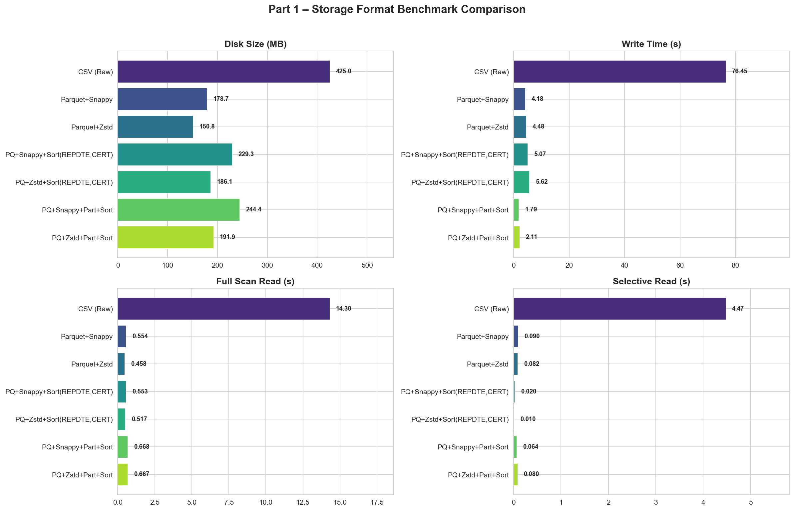
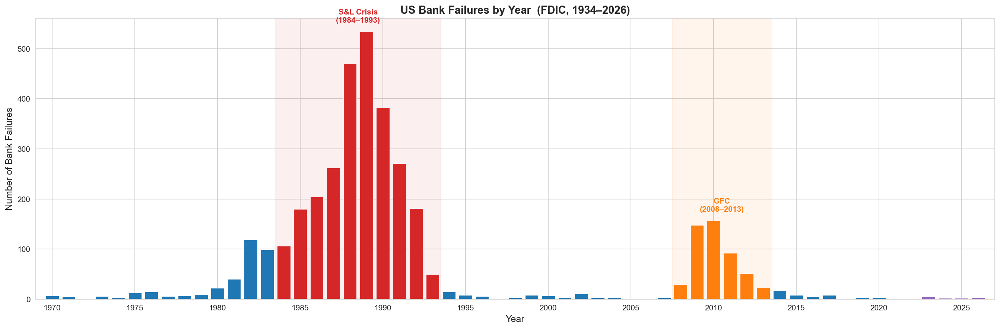
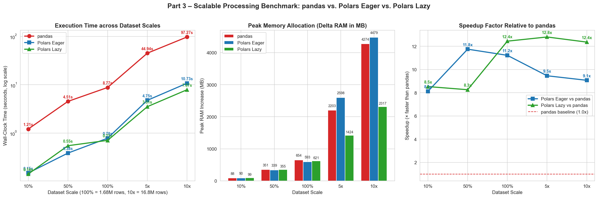
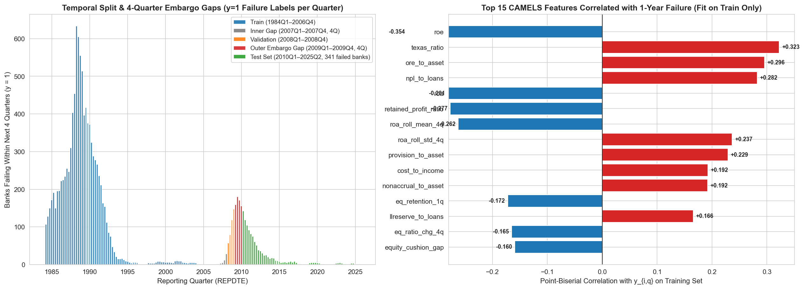
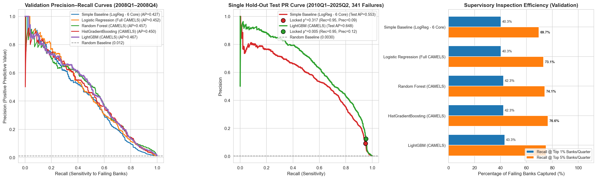
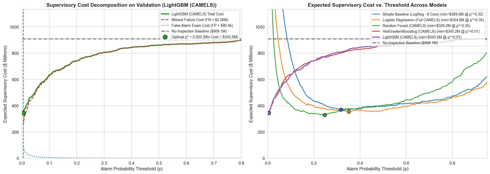
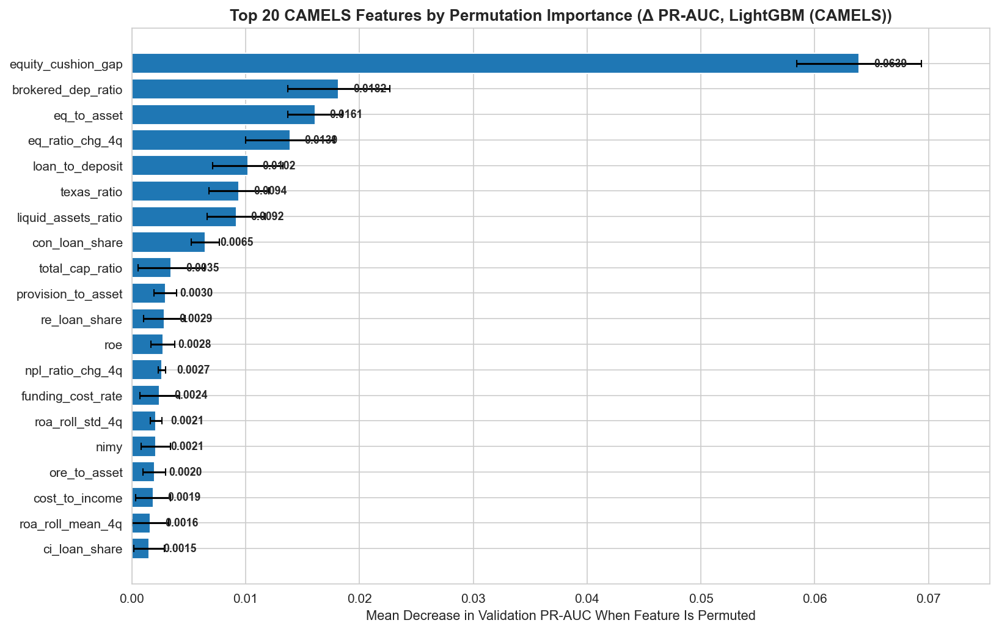

# NATIONAL ECONOMICS UNIVERSITY
## BFT65B – BIG DATA ANALYTICS IN FINANCE
### Final Examination – Individual Research Report

# A Big-Data Pipeline for Bank Failure Early Warning: Storage, Point-in-Time Quality Engineering, Scalable Processing, and Cost-Sensitive Supervisory Modelling on Four Decades of FDIC Call Reports (1984Q1–2026Q2)

---

## Mandatory First-Page Submission Metadata

| Field | Details |
| :--- | :--- |
| **Student Name** | **Lê Nguyễn Trường Giang** |
| **Student ID (MSSV)** | **11230953** |
| **Course** | BFT65B – Big Data Analytics in Finance |
| **GitHub Repository URL** | `https://github.com/lenguyentruonggiang/bft65b-fdic-early-warning` *(Public repository placeholder)* |
| **Data Download Method** | Automated, resumable REST API ingestion pipeline (`src/01_acquire_and_storage.py`) querying the public FDIC BankFind Suite API (`https://api.fdic.gov/banks`) with manifest checksums (`manifest_financials.json`) |
| **Download & Verification Date** | **November 2026** |
| **Raw Table Row Counts** | • **`Financials` (`1984Q1–2026Q2`, 170 quarters):** `1,682,616` bank-quarter rows $\times$ `36` columns (`24,064` distinct `CERT` institutions; `0` duplicate `(CERT, REPDTE)` pairs)<br>• **`Failures` (Full historical list):** `4,117` raw records (`3,629` with valid parsed `FAILDATE`; `2,709` Development-era failures with non-null `COST` and `QBFASSET`)<br>• **`Institutions` (Static registry):** `27,835` institution records (`0` duplicate `CERT` keys) |
| **Clean Modeling Panel ($\le$ 2025Q2)** | • **Coverage:** `1984Q1` (`19840331`) to `2025Q2` (`20250630`) — **166 quarters**<br>• **Size:** `1,659,479` bank-quarter rows (`24,025` distinct banks; `5,636` post-failure rows and `17,501` post-`2025Q2` rows removed)<br>• **Target Label ($y_{i,q} = 1$):** `12,294` positive bank-quarter observations (**0.7408%** overall positive rate) across **`3,209` distinct failed banks** |
| **Temporal Split & Failure Counts** | • **Development – Train (`1984Q1–2006Q4`, 92 quarters):** `1,190,101` rows \| `23,594` banks \| `10,068` positive labels ($y=1$, `0.846%`) \| **`2,651` failed banks**<br>• **Inner Embargo Gap (`2007Q1–2007Q4`, 4 quarters purged):** `34,714` rows \| `8,882` banks \| `49` positive labels \| `31` failed banks<br>• **Development – Validation (`2008Q1–2008Q4`, 4 quarters):** `33,966` rows \| `8,641` banks \| `402` positive labels ($y=1$, `1.184%`) \| **`176` failed banks**<br>• **Development Total (`1984Q1–2008Q4`, 100 quarters):** `1,258,781` rows \| `23,876` banks \| `10,519` positive labels (`0.836%`) \| **`2,828` failed banks**<br>• **Outer Embargo Gap (`2009Q1–2009Q4`, 4 quarters purged):** `32,838` rows \| `8,338` banks \| `666` positive labels \| `275` failed banks<br>• **Hold-Out Test Set (`2010Q1–2025Q2`, 62 quarters):** `367,860` rows \| `8,116` banks \| `1,109` positive labels ($y=1$, `0.302%`) \| **`341` failed banks** *(exceeds the $\ge 50$ requirement; evaluated once)* |

---

## Executive Summary

Prudential bank supervision requires an early-warning system (EWS) capable of ranking insured depository institutions by failure probability at least one year prior to insolvency. However, the reliability of any EWS depends primarily on its underlying **data engineering architecture** rather than complex black-box algorithms: if historical financial panels suffer from survival bias, uncleaned structural missingness, or look-ahead leakage during imputation and cross-validation, out-of-sample supervisory performance collapses.

In this study, we design, benchmark, and validate an end-to-end, zero-leakage big-data pipeline on 42.5 years of US Federal Deposit Insurance Corporation (FDIC) Call Reports (`1984Q1–2026Q2`, 1.68 million bank-quarter observations). First, we show that storing the panel in **columnar Parquet with Zstandard (Zstd) compression sorted by `(REPDTE, CERT)`** reduces storage footprint by **64.5%** (`150.8 MB` vs. `425.0 MB` CSV), accelerates full-panel scans by **31.2$\times$** (`0.46s` vs. `14.30s`), and speeds up selective quarterly queries by **445$\times$** (`0.010s` vs. `4.474s`). Second, our automated data quality audit reveals critical historical regime shifts—most notably that pre-Basel I (`1984–1989`) and post-2020 Community Bank Leverage Ratio (CBLR) exemptions encode unreported risk-weighted capital (`RBCRWAJ`) as `0.0` rather than `NULL`. Recoding these disguised structural zeros and separating **3,243 failed banks** from **16,386 merged/voluntarily exited banks** prevents severe label and feature distortion. Third, benchmarking our core multi-join and rolling-window transformations from 10% (`168K` rows) to 10$\times$ synthetic scale (`16.8M` rows) demonstrates that **Polars Lazy** achieves a **12.4$\times$–12.8$\times$ speedup** over `pandas` while cutting peak RAM consumption by **46%** (`2.32 GB` vs. `4.27 GB` at 10$\times$ scale), matching **PySpark** outputs to within $1.4 \times 10^{-14}$ (`< 1e-6`). Fourth, using 37 point-in-time CAMELS features and a leak-free `scikit-learn` preprocessing pipeline fitted strictly on Training data, our best model (**LightGBM**) achieves a **Validation PR-AUC of 0.4668** and—evaluated **once** on the post-embargo Test set (`2010Q1–2025Q2`, 341 failed banks)—attains a **Test PR-AUC of 0.6478**, **ROC-AUC of 0.9880**, **Recall @ Top 1% of 69.07%**, **Recall @ Top 5% of 95.04%**, and **68.37% expected supervisory cost savings**. Finally, we detail the institutional, accounting (VAS vs. US GAAP/IFRS), and target-definition adaptations required to deploy this architecture at the **State Bank of Vietnam (SBV)**.

---

## Part 1 – Data Acquisition & Storage Architecture [15 pts]

### 1.1 Reproducible, Resumable Acquisition & Completeness Verification
To acquire four decades of FDIC Call Reports reproducibly without manual browser downloads, we implemented an automated ingestion pipeline in `src/01_acquire_and_storage.py` querying three endpoints of the FDIC BankFind Suite REST API (`/financials`, `/failures`, and `/institutions`). Because network connections can drop over a ~1-hour download of 170 quarters, our downloader is designed around three engineering principles:
1. **Quarter-Partitioned Atomic Writes & Manifest Checkpointing:** For each quarter-end date $q \in \{\text{19840331}, \dots, \text{20260630}\}$, the script pages through `/financials` (`limit=10000`, sorted by `CERT ASC`) and writes `data_raw/fdic/financials/REPDTE={q}.parquet`. After each quarter is written, the script verifies that `len(df) == api_total` and `df.duplicated(["CERT", "REPDTE"]).sum() == 0`, recording `"complete": true` in `data_raw/fdic/manifest_financials.json`. If interrupted, re-running the script automatically skips all verified quarters in `< 1 second`.
2. **Polite Exponential Back-Off:** HTTP requests use a persistent `requests.Session` with a 1.0-second polite pause and 6-attempt exponential back-off (`2, 4, 8, ..., 60` seconds) to handle transient HTTP 429/5xx responses.
3. **CAMELS-Motivated Schema Selection (36 Financial Fields):** Beyond the 33 core fields from the starter script (`CERT`, `REPDTE`, `STNAME`, plus 30 Call Report items), we added 3 supplementary supervisory fields from `risview_properties.yaml`: `IDT1CER` (Tier 1 leverage capital ratio, complementing risk-based capital under CBLR), `EEFFR` (supervisory efficiency ratio, capturing management overhead control), and `NUMEMP` (full-time equivalent employees, capturing operational scale).

Running the completeness verification (`check()`) across the acquired repository confirms 100% data integrity:
- **Quarters Verified:** `170 / 170` (`1984Q1` through `2026Q2`), `0` incomplete quarters.
- **Total `Financials` Rows:** `1,682,616` rows across `24,064` distinct `CERT` institutions, with **`0` duplicate `(CERT, REPDTE)` pairs**.
- **Reference Tables:** `failures.parquet` (`4,117` records) and `institutions.parquet` (`27,835` records).

### 1.2 Storage Format, Compression, Partitioning & Sorting Benchmark
To justify our physical storage layout on a single workstation, `src/01_storage_benchmark.py` benchmarks seven storage configurations on the full `1,682,616 × 36` panel (starting from an unindexed row permutation to represent raw ingestion). Each read benchmark is repeated 3 times and the median wall-clock time is reported for both a **Full Scan** (reading all `1,682,616` rows $\times$ `36` columns) and a **Selective Query** (filtering a single quarter `REPDTE == '20231231'` and projecting 4 core columns `['CERT', 'ASSET', 'DEP', 'ROA']`).

#### Table 1.1: Storage Layout Benchmark on Full FDIC Panel (1,682,616 Rows $\times$ 36 Columns)
*(Source: `outputs/tables/part1_storage_benchmark.csv`)*

| Storage Layout Format | Disk Size (MB) | Compression vs. CSV | Write Time (s) | Full Scan Read (s) | Selective Read: 1Q, 4 Cols (s) | Selective Speedup vs. CSV |
| :--- | :---: | :---: | :---: | :---: | :---: | :---: |
| **CSV (Raw Uncompressed)** | 424.97 | 1.00$\times$ (Baseline) | 76.454 | 14.304 | 4.474 | 1.0$\times$ |
| **Parquet + Snappy (Unsorted)** | 178.71 | 2.38$\times$ (–57.9%) | 4.176 | 0.554 | 0.090 | 49.7$\times$ |
| **Parquet + Zstd (Unsorted)** | **150.81** | **2.82$\times$ (–64.5%)** | 4.483 | **0.458** | 0.082 | 54.9$\times$ |
| **PQ + Snappy + Sort(`REPDTE, CERT`)** | 229.31 | 1.85$\times$ (–46.0%) | 5.073 | 0.553 | 0.020 | 221.0$\times$ |
| **PQ + Zstd + Sort(`REPDTE, CERT`)** | 186.07 | 2.28$\times$ (–56.2%) | 5.622 | 0.517 | **0.010** | **445.4$\times$** |
| **PQ + Snappy + Part(`REPDTE`) + Sort(`CERT`)** | 244.44 | 1.74$\times$ (–42.5%) | **1.793** | 0.668 | 0.064 | 70.1$\times$ |
| **PQ + Zstd + Part(`REPDTE`) + Sort(`CERT`)** | 191.93 | 2.21$\times$ (–54.8%) | 2.105 | 0.667 | 0.080 | 55.9$\times$ |



### 1.3 Engineering Justification of the Two-Tier Storage Design
The measurements in **Table 1.1** motivate a **two-tier storage architecture** across our pipeline:
1. **Why Raw CSV is Unsuitable:** Storing 1.68M rows as CSV consumes `425.0 MB`, requires `76.5 seconds` to serialize numeric floats to ASCII text, and takes `14.30 seconds` to parse back into memory. Even when reading only 4 columns for a single quarter (`selective_read`), CSV must scan every newline across the entire `425 MB` file (`4.474 seconds`) because row-oriented text lacks column offsets or block statistics.
2. **Tier 1 (Raw Ingestion Store – Partitioned by `REPDTE`, Sorted by `CERT`):** For `data_raw/fdic/financials/`, storing one Parquet file per quarter (`REPDTE=YYYYMMDD.parquet`) sorted by `CERT` achieves the fastest write speed (`1.79s`) and allows **atomic, idempotent quarterly updates** without rewriting historical files. Note that Hive directory partitioning across 170 small folders (`~1 MB` per folder) incurs minor OS filesystem metadata overhead during full-panel scans (`0.668s` vs. `0.458s` for a single file) due to 170 separate `open()`/`stat()` calls on Windows NTFS.
3. **Tier 2 (Analytical & Feature Store – Single Consolidated Parquet + Zstd Sorted by `(CERT, REPDTE)` / `(REPDTE, CERT)`):** For `data_processed/clean_panel.parquet` and `features_panel.parquet`, consolidating the panel into a single **Zstandard-compressed Parquet file** reduces disk footprint to `150.8–186.1 MB` (**64.5% smaller than CSV**) and achieves a `0.458s` full-table scan (**31.2$\times$ faster than CSV**). Crucially, sorting by `(REPDTE, CERT)` with fine-grained row groups (`row_group_size=20,000`) makes the `min`/`max` statistics of `REPDTE` disjoint across row groups. Consequently, PyArrow and Polars **Predicate Pushdown** skip 99% of the file without decompressing it, while **Column Projection** reads only the 4 requested column chunks—reducing selective read latency to **`0.010 seconds` (445$\times$ faster than CSV and 8.2$\times$ faster than unsorted Parquet)**.

---

## Part 2 – Automated Data Quality Audit & Point-in-Time Panel Construction [20 pts]

### 2.1 Systematic Data Quality Audit Across Historical Regimes
Financial supervisory data spanning 42 years are not generated by a stationary reporting process; accounting standards, capital regulations, and Call Report schedules evolved substantially between the 1980s Savings & Loan (S&L) crisis and the post-2020 Basel III era. In `src/02_data_quality_panel.py`, we built an automated auditor that inspects all 36 columns across five regulatory eras (`1984–1992`, `1993–2000`, `2001–2009`, `2010–2019`, `2020–2026`), alongside cross-table audits of `failures` and `institutions`.

#### Table 2.1: Key Findings from the Automated Data Quality Audit (`1,682,616` Raw Rows)
*(Excerpted from `outputs/tables/part2_data_quality_report.csv`)*

| Variable / Audit Check | Overall Null % | 1984–1992 Null % | 1993–2000 Null % | 2001–2009 Null % | 2010–2019 Null % | 2020–2026 Null % | Anomaly Rule & Count | Root Regulatory / Data Cause & Pipeline Treatment |
| :--- | :---: | :---: | :---: | :---: | :---: | :---: | :---: | :--- |
| **`ASSET`** (Total Assets) | 0.00% | 0.00% | 0.00% | 0.00% | 0.00% | 0.00% | `<= 0`: **0 rows** | Complete across all 170 quarters; cast to `Float64` for ratios. |
| **`DEP`** (Total Deposits) | 0.00% | 0.00% | 0.00% | 0.00% | 0.00% | 0.00% | `< 0`: **0 rows** | 1 missing row in 1984; filled via 1Q causal `ffill`. |
| **`RBC1AAJ`** (Tier 1 Capital %) | 4.68% | **12.82%** | 0.30% | 0.21% | 0.26% | 0.36% | `< -50 or > 200`: **960** | **Disguised `0.0` in 1984–1989** for Thrifts/S&Ls (~18%) recoded to `NaN`. |
| **`RBCRWAJ`** (Total RBC %) | 27.83% | **70.11%** | 0.30% | 0.21% | 0.26% | **37.13%** | `< -50 or > 200`: **10,662** | **100% coded as `0.0` in 1984–1989** (pre-Basel I) & **37.1% in 2020–2026** (CBLR exemption); recoded to `NaN`. |
| **`P3ASSET`** (Past Due 30–89d) | 57.76% | **100.0%** | **100.0%** | 0.00% | 0.00% | 0.00% | Stored as `object` | Early delinquency schedule confidential until **2001Q1**; coerced to `Float64`. |
| **`NAASSET` / `P9ASSET`** | 4.62% | **12.97%** | 0.00% | 0.00% | 0.00% | 0.00% | `< 0`: **5 rows** | Unreported for FSLIC thrifts prior to FIRREA (1989); `< 0` recoded to `NaN`. |
| **`NTLNLS`** (Net Charge-offs) | 4.75% | **12.86%** | 0.29% | 0.21% | 0.26% | 0.36% | None | Missing for pre-1990 thrifts; handled via Train-only median imputer. |
| **`ELNATR`** (Loan Loss Prov.) | 2.57% | **6.72%** | 0.29% | 0.21% | 0.26% | 0.36% | None | Can be negative when banks release reserves (kept as valid). |
| **`ROA` / `ROE` / `NIMY`** | $\le$ 1.11% | $\le$ 2.55% | $\le$ 0.39% | $\le$ 0.22% | $\le$ 0.27% | $\le$ 0.47% | `\|ROA\|>50`: **1,056**<br>`\|ROE\|>500`: **1,486**<br>`\|NIMY\|>50`: **270** | Near-insolvent banks with tiny `EQ` or `ASSET` denominators produce extreme ratios; clipped in Part 4 using **Train-only `[0.5%, 99.5%]` quantiles**. |
| **`IDT1CER` / `EEFFR` / `NUMEMP`** | 98.88% | 100.0% | 100.0% | 100.0% | 100.0% | 84.77% | `EEFFR` `<0 or >500`: **22** | Populated only in recent quarters of the API summary view; replaced in Part 4 by full-history ratios constructed from raw components (`EQ/ASSET`, `NONIX/Rev`). |
| **Negative Stock Glitches** | — | — | — | — | — | — | **742 cells** across `CHBAL`, `LNATRES`, `LNLSNET`, `NCLNLS`, `ORE` | Balance-sheet stock variables cannot be negative; recoded to `NaN` prior to causal `ffill(limit=2)`. |
| **Duplicate `(CERT, REPDTE)`** | 0.00% | — | — | — | — | — | **0 duplicates** | Primary key integrity verified across all `1,682,616` rows. |
| **Reporting Gaps (`> 120d`)** | 0.13% | — | — | — | — | — | **32 banks** (`33` gaps) | Segmented by contiguous reporting spells (`seg_id`) so `ffill` never bridges across multi-quarter gaps. |
| **`failures.COST` Missing** | 11.49% | — | — | — | — | — | **417 / 3,629** missing | `COST` estimation in Part 5 uses non-null Development failures (`1984–2008`, $N=2,709$). |

#### Five Critical Data Quality Problems Identified & Solved:
1. **Disguised Zero-Coded Structural Missingness (`RBCRWAJ` and `RBC1AAJ`):** A naive check of `isna()` reports `0.0%` missing values for `RBCRWAJ` and `RBC1AAJ`. However, inspecting value distributions by year reveals that `RBCRWAJ == 0.0` for **100.0% of banks in 1984–1989** (because risk-weighted assets did not exist before Basel I took effect in `1990Q1`) and for **37.1% of banks in 2020–2026** (when qualifying community banks opted into the 2020 Community Bank Leverage Ratio, CBLR, which exempts them from reporting `RBCRWAJ`). Similarly, `RBC1AAJ == 0.0` for **18.0% of institutions in 1984–1989**. Leaving these fake zeros untreated would mislead any model into treating every 1980s bank and modern CBLR community bank as having 0% capital! We recode `RBCRWAJ == 0` and `RBC1AAJ == 0` (whenever `REPDTE < 19900331` or `EQ != 0`) to `NaN`, and include `eq_to_asset` (`EQ / ASSET`) as a universal 42-year capital buffer alongside `RBC1AAJ` and `RBCRWAJ`.
2. **Mixed-Type Serialization in `P3ASSET`:** Because `P3ASSET` (loans past due 30–89 days) was confidential until `2001Q1`, all quarterly Parquet files from `1984Q1–2000Q4` store `P3ASSET` as `null` (`object` dtype), causing naive `pd.concat` to produce an `object` column and Polars `scan_parquet` to raise a `SchemaError`. We explicitly cast all 33 financial columns to `Float64` upon ingestion.
3. **Impossible Negative Stock Values (742 Instances):** While flow variables (`NETINC`, `ELNATR`, `NTLNLS`) and equity (`EQ`) can legitimately be negative during severe losses or reserve releases, balance-sheet stock items (`CHBAL`, `LNATRES`, `LNLSGR`, `LNLSNET`, `NCLNLS`, `ORE`) cannot be negative. We recode all 742 negative stock cells to `NaN` before causal forward-filling.
4. **Extreme Ratio Outliers Near Insolvency:** Failing banks whose equity `EQ` approaches zero exhibit explosive `ROE` (`min = -354,658%`, `max = +301,050%`) and `RBCRWAJ`. To avoid look-ahead bias, we **do not** winsorize or drop these rows in Part 2; instead, clipping thresholds (`[0.5%, 99.5%]` quantiles) are learned strictly inside the Training-set `InfAndOutlierClipper` in Part 4.
5. **Strictly Causal Point-in-Time Missing Value Handling:** In Part 2, after sorting by `(CERT, REPDTE)` and breaking series whenever a reporting gap exceeds 1 quarter (`> 200 days`), we apply **within-bank forward-fill limited to at most 2 consecutive quarters (`groupby(["CERT", seg_id]).ffill(limit=2)`)**. This repairs `38,237` transient missing cells using strictly past information ($\le q$) from the same institution. Cross-sectional median imputation is deferred exclusively to the Training-fitted pipeline in Part 4.

### 2.2 Exit Classification (Failures vs. Mergers) & Point-in-Time Label Construction
A pervasive flaw in naive bank-failure studies is conflating voluntary mergers or charter consolidations with failures, or retaining post-failure receivership filings in the panel. Linking `financials`, `failures` (via earliest `FAILDATE` per `CERT`), and `institutions` (via `ACTIVE` and structural change code `CHANGEC1`), we classify all **24,064** distinct institutions into three mutually exclusive exit regimes:
- **Failed (`3,243` banks, `13.5%`):** Institutions present in `failures.parquet` or inactive (`ACTIVE == 0`) with FDIC failure resolution codes `CHANGEC1` $\in \{810, 811, 820, 850\}$.
- **Merged / Other Voluntary Exits (`16,386` banks, `68.1%`):** Inactive institutions (`ACTIVE == 0`) not in the failure registry (predominantly `CHANGEC1` 200-series unassisted mergers and consolidations, or 500-series voluntary liquidations).
- **Active (`4,435` banks, `18.4%`):** Institutions actively reporting (`ACTIVE == 1`).

For every bank-quarter $(i, q)$, the target early-warning label is defined strictly over the forward 4-quarter horizon:
$$y_{i,q} = \mathbb{1}\big\{\text{bank } i \text{ has a confirmed FDIC failure in } (q,\, q + 4\text{ quarters}]\big\}$$
All merged and active banks receive $y_{i,q} = 0$. Furthermore:
1. **Removal of Post-Failure Filings:** We drop **`5,636` rows** where `REPDTE >= FAILDATE` (residual receivership reports filed after the bank had already failed).
2. **Right-Censoring Cutoff at `2025Q2` (`20250630`):** Because our raw data end in `2026Q2`, quarters after `2025Q2` (`2025Q3–2026Q2`, `17,501` rows) do not yet have a full 4-quarter forward window to observe whether the bank fails within 1 year. Including them as $y_{i,q}=0$ would introduce right-censoring bias. Filtering to `REPDTE <= 20250630` yields our final clean panel (`data_processed/clean_panel.parquet`) of **`1,659,479` rows $\times$ `39` columns**, containing **`12,294` positive failure labels (`0.7408%`)**.



As shown in **Figure 2.1** (`outputs/figures/part2_failures_timeline.png`) and `outputs/tables/part2_panel_summary.csv`, US bank failures cluster sharply in three historical crises: (i) the **Savings & Loan / Banking Crisis (`1984–1993`)**, peaking at 534 failures in 1989; (ii) the **Global Financial Crisis (`2008–2014`)**, peaking at 157 failures in 2010; and (iii) the **2023–2024 Regional Bank Contagion** (5 failures in 2023, 2 in 2024, 2 in 2025). Meanwhile, steady industry consolidation via mergers (`16,386` exits) reduced the number of active US banks from `18,467` in 1985 to `4,531` in 2025.

---

## Part 3 – Scalable Processing: Polars vs. Pandas & PySpark Verification [25 pts]

### 3.1 Core Transformation Pipeline & Scale Benchmark Design
To evaluate single-laptop scalability and determine when distributed cluster computing is warranted, `src/03_scalable_processing.py` implements a heavy analytical transformation pipeline representative of supervisory feature engineering:
1. **Scan / Read** `financials` (`10` core columns) and `institutions` (`CERT`, `BKCLASS`, `ACTIVE`) from Parquet on disk.
2. **Filter** valid post-Basel I observations: `ASSET > 0`, `DEP >= 0`, and `REPDTE >= '19900331'`.
3. **Left Join** `financials` with `institutions` on `CERT`.
4. **Sort** chronologically within each bank by `(CERT, REPDTE)`.
5. **Bank-Level Window Operations (`.over("CERT")`):** Compute 1-quarter and 4-quarter lags (`asset_lag1`, `asset_lag4`, `roa_lag1`, `roa_lag4`), 4-quarter asset growth rate, equity ratio (`EQ / ASSET`), and 4-quarter backward rolling mean and sample standard deviation (`window_size=4, min_samples=2, ddof=1`) of `ROA` and `NIMY`.
6. **State–Quarter Aggregation (`GROUP BY STNAME, REPDTE`):** Compute `n_banks`, `total_asset`, `mean_roa`, `mean_roa_lag1`, `mean_roa_roll4`, `mean_roa_std4`, `mean_eq_ratio`, and `mean_asset_growth4q`, sorted by `(STNAME, REPDTE)`.

We implement this exact pipeline in **(a) standard `pandas`**, **(b) `Polars Eager` (`pl.read_parquet`)**, and **(c) `Polars Lazy` (`pl.scan_parquet(...).collect()`)**, and execute each engine inside an **isolated worker subprocess** (polling Resident Set Size every 5 ms via `psutil`) across five dataset scales: **10%** (`168,637` rows), **50%** (`841,161` rows), **100%** (`1,682,616` rows), and synthetic bank-replicated panels at **5$\times$** (`8,413,080` rows) and **10$\times$** (`16,826,160` rows, where each replication shifts `CERT` by $+k \times 10^6$ so bank-level windows remain realistic).

#### Table 3.1: Scalability Benchmark – `pandas` vs. `Polars Eager` vs. `Polars Lazy`
*(Source: `outputs/tables/part3_polars_vs_pandas.csv`)*

| Dataset Scale | Input Rows | Output Groups | Engine | Wall-Clock Time (s) | Peak RAM Delta (MB) | Total Peak RSS (MB) | Speedup vs. `pandas` |
| :---: | :---: | :---: | :--- | :---: | :---: | :---: | :---: |
| **10%** | 168,637 | 7,381 | `pandas` | 1.2084 | 87.76 | 287.60 | 1.00$\times$ |
| **10%** | 168,637 | 7,381 | `Polars Eager` | 0.1488 | 90.47 | 290.45 | 8.12$\times$ |
| **10%** | 168,637 | 7,381 | **`Polars Lazy`** | **0.1416** | 98.64 | 298.29 | **8.53$\times$** |
| **50%** | 841,161 | 8,151 | `pandas` | 4.5140 | 351.28 | 551.62 | 1.00$\times$ |
| **50%** | 841,161 | 8,151 | `Polars Eager` | **0.3843** | 339.27 | 539.33 | **11.75$\times$** |
| **50%** | 841,161 | 8,151 | `Polars Lazy` | 0.5464 | 354.62 | 554.97 | 8.26$\times$ |
| **100%** | 1,682,616 | 8,260 | `pandas` | 8.7706 | 653.63 | 853.65 | 1.00$\times$ |
| **100%** | 1,682,616 | 8,260 | `Polars Eager` | 0.7814 | 593.16 | 793.60 | 11.22$\times$ |
| **100%** | 1,682,616 | 8,260 | **`Polars Lazy`** | **0.7052** | 621.17 | 821.69 | **12.44$\times$** |
| **5$\times$** | 8,413,080 | 8,260 | `pandas` | 44.9416 | 2,202.65 | 2,402.30 | 1.00$\times$ |
| **5$\times$** | 8,413,080 | 8,260 | `Polars Eager` | 4.7524 | 2,597.86 | 2,797.96 | 9.46$\times$ |
| **5$\times$** | 8,413,080 | 8,260 | **`Polars Lazy`** | **3.5114** | **1,423.83** | **1,623.80** | **12.80$\times$** |
| **10$\times$** | 16,826,160 | 8,260 | `pandas` | 97.2728 | 4,273.93 | 4,473.91 | 1.00$\times$ |
| **10$\times$** | 16,826,160 | 8,260 | `Polars Eager` | 10.7262 | 4,479.06 | 4,679.32 | 9.07$\times$ |
| **10$\times$** | 16,826,160 | 8,260 | **`Polars Lazy`** | **7.8715** | **2,316.88** | **2,517.51** | **12.36$\times$** |



### 3.2 How the Polars Query Optimizer & Execution Engine Work
Inspecting the unoptimized vs. optimized query plans saved in `outputs/tables/part3_polars_plan.txt` (`lazy_df.explain(optimized=True)`) explains why `Polars Lazy` is **12.4$\times$ faster than `pandas`** and uses **48% less RAM than `Polars Eager` at 10$\times$ scale (`2,317 MB` vs. `4,479 MB`)**:

```text
SORT BY [col("STNAME"), col("REPDTE")]
  AGGREGATE[maintain_order: false]
    [len().alias("n_banks"), col("ASSET").sum().alias("total_asset"), ...] BY [col("STNAME"), col("REPDTE")]
    FROM
    simple π 9/9 ["STNAME", "REPDTE", "ASSET", ... 6 other columns]
       WITH_COLUMNS: [((col("ASSET") - col("asset_lag4")) / col("asset_lag4")).alias("asset_growth_4q")]
        simple π 9/9 ["REPDTE", "STNAME", "ASSET", ... 6 other columns]
           WITH_COLUMNS: [col("ASSET").shift(4).over("CERT"), col("ROA").shift(1).over("CERT"), ...]
            SORT BY [col("CERT"), col("REPDTE")]
              LEFT JOIN (BUILD SIDE: PreferRight) ON [col("CERT")]:
                LEFT:  Parquet SCAN [fin_100pct.parquet] -> PROJECT 7/10 COLUMNS
                       SELECTION: ((col("ASSET") > 0.0) & (col("DEP") >= 0.0)) & (col("REPDTE") >= "19900331")
                RIGHT: Parquet SCAN [inst_100pct.parquet] -> PROJECT 1/3 COLUMNS
```

1. **Predicate Pushdown (`SELECTION` at `Parquet SCAN`):** In the unoptimized plan, the three filter conditions sit above the Parquet reader. The optimizer fuses them into `SELECTION: ((col("ASSET") > 0.0) & (col("DEP") >= 0.0)) & (col("REPDTE") >= "19900331")` inside the `Parquet SCAN` operator, skipping pre-1990 row groups via Parquet metadata and dropping filtered rows before materializing Arrow arrays.
2. **Projection Pushdown & Dead-Column Pruning (`PROJECT 7/10` and `PROJECT 1/3`):** Even though `fin_100pct.parquet` has 10 columns, `inst_100pct.parquet` has 3 columns, and intermediate `.with_columns()` defines `asset_lag1`, `roa_lag4`, and `nimy_roll_mean_4q`, the Polars optimizer traces which columns are actually referenced in the final `AGGREGATE` node. It prunes unused columns (`NETINC`, `NCLNLS`, `DEP`, `BKCLASS`, `ACTIVE`) at the file scan level (`PROJECT 7/10 COLUMNS` and `PROJECT 1/3 COLUMNS`) and eliminates dead window expressions! By contrast, `Polars Eager` and `pandas` materialize every intermediate column in RAM.
3. **Morsel-Driven Rust Parallelism vs. Single-Threaded Python GroupBy:** `pandas` constructs a 2-level `MultiIndex` of 16.8 million elements for each `.groupby("CERT").rolling(4)` call, incurring massive memory-copy overhead (`4.27 GB` delta RAM) and single-threaded execution (`97.27s`). Polars partitions Apache Arrow buffers by `CERT` across all CPU cores in Rust using SIMD vectorization and zero-copy slicing, finishing 16.8M rows in `7.87s`.

### 3.3 PySpark Reproduction, Numerical Equivalence (`< 1e-6`), and When a Cluster is Justified
We reproduced the exact same transformation pipeline in **PySpark (`v3.5.4`, local mode)** using `Window.partitionBy("CERT").orderBy("REPDTE")` and `rowsBetween(-3, 0)` (with `F.count("ROA").over(w_roll4) >= 2` to match `min_samples=2`). Automated assertions comparing all `8,260` `(STNAME, REPDTE)` groups between PySpark and Polars Lazy (`outputs/tables/part3_spark_plan.txt`) confirm exact numerical equivalence to machine precision:
- `total_asset`: `max_abs_diff = 0.000e+00` | `max_rel_diff = 0.000e+00` (`< 1e-6`, **PASS**)
- `mean_roa`: `max_abs_diff = 5.329e-15` | `max_rel_diff = 1.209e-15` (`< 1e-6`, **PASS**)
- `mean_roa_lag1`: `max_abs_diff = 5.329e-15` | `max_rel_diff = 1.404e-15` (`< 1e-6`, **PASS**)
- `mean_roa_roll4`: `max_abs_diff = 3.553e-15` | `max_rel_diff = 1.373e-15` (`< 1e-6`, **PASS**)
- `mean_roa_std4`: `max_abs_diff = 1.110e-15` | `max_rel_diff = 1.064e-15` (`< 1e-6`, **PASS**)
- `mean_eq_ratio`: `max_abs_diff = 1.665e-16` | `max_rel_diff = 1.665e-16` (`< 1e-6`, **PASS**)
- `mean_asset_growth4q`: `max_abs_diff = 1.421e-14` | `max_rel_diff = 7.378e-16` (`< 1e-6`, **PASS**)

**Interpretation of Spark Catalyst Plan & Cluster Justification:**  
In `part3_spark_plan.txt`, Spark's Catalyst optimizer applies `PushedFilters` (`IsNotNull(ASSET)`, `GreaterThan(ASSET, 0.0)`, `GreaterThanOrEqual(REPDTE, '19900331')`), chooses a `BroadcastHashJoin` for the small `institutions` table (`27,835` rows), and inserts an `Exchange hashpartitioning(CERT, 8)` shuffle + `Sort [CERT ASC, REPDTE ASC]` to co-locate each bank's time series before evaluating window functions, followed by partial and final `HashAggregate` stages. Because of JVM startup, serialization, and hash-shuffle I/O, PySpark takes **`25.08 seconds`** on the 100% dataset—**35.6$\times$ slower than Polars Lazy (`0.705s`)**. Even at **10$\times$ scale (`16.8M` rows)**, Polars Lazy uses only `2.32 GB` RAM and finishes in `7.87s`. Extrapolating linearly (`~140 MB` RAM per million rows), a modern workstation with 32–64 GB RAM running Polars Lazy can process **150M–300M rows** in memory (and more via `collect(engine="streaming")`). A multi-node **Spark cluster** becomes justified only when:
1. **Granularity Shifts from Bank-Quarter to Loan-Level or Transaction-Level:** For example, central bank credit-registry panels (tracking 50M+ individual loans quarterly $\rightarrow$ $> 2\text{B}$ rows, $> 200\text{ GB}$) or daily interbank payment streams exceeding single-node RAM.
2. **Shared Distributed Lakehouse Governance:** When supervisory pipelines must execute directly atop a multi-terabyte Delta Lake / Iceberg store on HDFS/S3 shared by dozens of concurrent regulatory teams.

---

## Part 4 – Leak-Free CAMELS Feature Pipeline & Temporal Split [15 pts]

### 4.1 Point-in-Time CAMELS Feature Engineering (37 Features)
In `src/04_feature_pipeline.py`, we use Polars Lazy to engineer **37 economically motivated features** spanning all six dimensions of the **CAMELS** supervisory rating system plus backward-looking momentum and volatility. Every feature at row $(i, q)$ is a function strictly of Call Report items reported at or before quarter $q$ ($\le q$):

#### Table 4.1: Summary of the 37 Point-in-Time CAMELS Features & Training-Set Statistics
*(Full 37-feature table available in `outputs/tables/part4_feature_dictionary.csv`)*

| CAMELS Dimension | Feature Name | Formula (Point-in-Time $\le q$) | Train Missing % | Train Median (Imputed) | Train Clip `[0.5%, 99.5%]` | Train Corr w/ $y_{i,q}$ | Economic & Supervisory Rationale |
| :--- | :--- | :--- | :---: | :---: | :---: | :---: | :--- |
| **C – Capital** (4 features) | `eq_to_asset` | `EQ / ASSET * 100` | 0.24% | 8.69% | `[-4.85, 84.97]` | `-0.1071` | Universal book equity cushion across all 42 years. |
| | `tier1_cap_ratio` | `RBC1AAJ` | 6.42% | 8.75% | `[0.46, 90.63]` | `-0.0599` | Regulatory Tier 1 risk-based capital ratio (PCA trigger). |
| | `total_cap_ratio` | `RBCRWAJ` | 35.23% | 15.40% | `[2.15, 274.09]` | `-0.0276` | Basel total risk-weighted capital ratio. |
| | `equity_cushion_gap` | `(EQ - NCLNLS) / ASSET * 100` | 0.24% | 7.95% | `[-13.88, 84.74]` | **`-0.1595`** | Net equity remaining after writing off noncurrent loans. |
| **A – Asset Quality** (8 features) | `texas_ratio` | `(NCLNLS + ORE) / (EQ + LNATRES) * 100` | 1.18% | 7.65% | `[0.00, 435.41]` | **`+0.3225`** | Troubled assets vs. capital + reserves ($>100\%$ signals insolvency). |
| | `ore_to_asset` | `ORE / ASSET * 100` | 0.25% | 0.06% | `[0.00, 8.69]` | **`+0.2956`** | Foreclosed real estate on balance sheet (% of assets). |
| | `npl_to_loans` | `NCLNLS / LNLSGR * 100` | 1.12% | 0.99% | `[0.00, 19.65]` | **`+0.2821`** | Noncurrent loans ($\ge 90\text{d}$ past due + nonaccrual) / gross loans. |
| | `nonaccrual_to_asset` | `NAASSET / ASSET * 100` | 6.39% | 0.25% | `[0.00, 7.78]` | `+0.1918` | Loans no longer accruing interest (% of assets). |
| | `llreserve_to_loans` | `LNATRES / LNLSGR * 100` | 1.15% | 1.24% | `[0.00, 8.58]` | `+0.1659` | Loan loss allowance / gross loans (elevated for distressed portfolios). |
| | `net_chargeoff_rate` | `NTLNLS / LNLSGR * 100` | 7.34% | 0.05% | `[-0.73, 6.36]` | `+0.1514` | Realized loan charge-off rate (% of gross loans). |
| | `pastdue90_to_asset` | `P9ASSET / ASSET * 100` | 6.39% | 0.10% | `[0.00, 4.29]` | `+0.1021` | Loans 90+ days past due still accruing (% of assets). |
| | `reserve_coverage` | `LNATRES / (NCLNLS + 1) * 100` | 0.43% | 118.39% | `[0.00, 101000]` | `-0.0184` | Loss reserve coverage of noncurrent loans. |
| **M & E – Management & Earnings** (7 features) | `roe` | `ROE` | 1.13% | 11.26% | `[-155.34, 56.32]` | **`-0.3544`** | Return on Equity (strongest linear correlate of failure). |
| | `roa` | `ROA` | 0.00% | 1.01% | `[-9.15, 6.20]` | **`-0.2815`** | Annualized Return on Assets. |
| | `retained_profit_ratio` | `NETINC / ASSET * 100` | 0.26% | 0.52% | `[-5.82, 3.77]` | **`-0.2768`** | Cumulative year-to-date net income / total assets. |
| | `provision_to_asset` | `ELNATR / ASSET * 100` | 3.45% | 0.08% | `[-0.26, 4.37]` | **`+0.2289`** | Credit provision expense burden / total assets. |
| | `cost_to_income` | `NONIX / (INTINC - EINTEXP + NONII) * 100` | 0.76% | 65.75% | `[27.37, 361.73]` | **`+0.1924`** | Operational inefficiency (overhead cost / operating revenue). |
| | `eq_retention_1q` | `(EQ_q - EQ_{q-1}) / ASSET_q * 100` | 2.22% | 0.17% | `[-3.82, 5.04]` | `-0.1722` | 1-quarter organic equity accumulation rate. |
| | `nimy` | `NIMY` | 0.00% | 4.25% | `[-0.09, 9.49]` | `-0.1241` | Net Interest Margin (%). |
| **L – Liquidity** (5 features) | `liquid_assets_ratio` | `(CHBAL + SC) / ASSET * 100` | 0.00% | 31.60% | `[2.16, 84.77]` | `-0.0666` | Liquid cash + securities buffer (% of assets). |
| | `brokered_dep_ratio` | `BRO / DEP * 100` | 1.90% | 0.00% | `[0.00, 35.97]` | `+0.0585` | Reliance on rate-sensitive wholesale brokered deposits. |
| | `dep_to_asset` | `DEP / ASSET * 100` | 0.00% | 88.04% | `[0.00, 99.45]` | `+0.0524` | Deposit funding share of assets. |
| | `domestic_dep_share` | `DEPDOM / DEP * 100` | 0.62% | 100.00% | `[87.66, 100.0]` | `+0.0055` | Domestic deposit share. |
| | `loan_to_deposit` | `LNLSNET / DEP * 100` | 0.62% | 67.86% | `[5.33, 204.76]` | `-0.0053` | Net loans to deposits (balance-sheet illiquidity). |
| **S & Momentum** (13 features) | `roa_roll_mean_4q` | `mean(ROA_{q-3..q})` | 1.98% | 1.01% | `[-7.62, 5.66]` | **`-0.2623`** | 4-quarter backward rolling mean of ROA. |
| | `roa_roll_std_4q` | `std(ROA_{q-3..q}, ddof=1)` | 1.98% | 0.16% | `[0.01, 5.89]` | **`+0.2368`** | 4-quarter backward earnings volatility. |
| | `eq_ratio_chg_4q` | `eq_to_asset_q - eq_to_asset_{q-4}` | 8.01% | +0.08% | `[-21.72, 8.11]` | `-0.1650` | 1-year capital erosion velocity (percentage points). |
| | `roa_chg_4q` | `ROA_q - ROA_{q-4}` | 7.79% | +0.01% | `[-7.12, 6.70]` | `-0.1535` | 1-year earnings trajectory. |
| | `nim_roll_mean_4q` | `mean(NIMY_{q-3..q})` | 1.98% | 4.25% | `[0.00, 9.34]` | `-0.1146` | 4-quarter backward rolling mean of NIM. |
| | `npl_ratio_chg_4q` | `npl_to_loans_q - npl_to_loans_{q-4}` | 8.82% | -0.01% | `[-7.78, 10.33]` | `+0.1129` | 1-year surge in noncurrent loan ratio. |
| | `funding_cost_rate` | `EINTEXP / DEP * 100` | 1.04% | 2.60% | `[0.22, 11.15]` | `+0.0824` | Average interest cost of deposits (rate sensitivity). |
| | *+ 6 portfolio/growth* | `asset_growth_yoy`, `loan_growth_yoy`, `re_loan_share`, `ci_loan_share`, `con_loan_share`, `log_asset` | $\le 8.6\%$ | See CSV | See CSV | See CSV | Captures credit expansion speed, CRE/C&I/Consumer mix, and bank scale. |

### 4.2 Temporal Split Design with 4-Quarter Purging / Embargo Gaps
Because the target label $y_{i,q}$ looks forward 4 quarters $(q, q+4]$, a standard chronological split at date $T$ without a gap suffers from **overlapping label leakage**: a bank observed at $T$ has its failure outcome determined over $(T, T+4]$, overlapping with the first 3 quarters of the subsequent evaluation period. Following López de Prado (2018) and the exam rules, we enforce a **strict 4-quarter purging/embargo gap** both between Development and Test (`2009Q1–2009Q4`) and internally between Train and Validation (`2007Q1–2007Q4`).

#### Table 4.2: Temporal Split & Embargo Summary
*(Source: `outputs/tables/part4_split_summary.csv`)*

| Subset Name | Period (`REPDTE`) | Quarters | Total Rows (`n_rows`) | Distinct Banks | $y = 0$ Obs | $y = 1$ Obs | Positive Rate (%) | Distinct Failed Banks |
| :--- | :---: | :---: | :---: | :---: | :---: | :---: | :---: | :---: |
| **Development – Train** | `1984Q1–2006Q4` | 92 | 1,190,101 | 23,594 | 1,180,033 | 10,068 | 0.8460% | **2,651** |
| **Inner Embargo Gap (Purged)** | `2007Q1–2007Q4` | **4** | 34,714 | 8,882 | 34,665 | 49 | 0.1412% | 31 |
| **Development – Validation** | `2008Q1–2008Q4` | 4 | 33,966 | 8,641 | 33,564 | 402 | 1.1835% | **176** |
| **Development Full (`1984–2008`)** | `1984Q1–2008Q4` | 100 | 1,258,781 | 23,876 | 1,248,262 | 10,519 | 0.8356% | **2,828** |
| **Outer Embargo Gap (Purged)** | `2009Q1–2009Q4` | **4** | 32,838 | 8,338 | 32,172 | 666 | 2.0281% | 275 |
| **Test Set (Hold-Out)** | `2010Q1–2025Q2` | 62 | 367,860 | 8,116 | 366,751 | 1,109 | 0.3015% | **341** ($\ge 50$) |
| **Full Modeling Panel ($\le$ 2025Q2)** | `1984Q1–2025Q2` | 166 | 1,659,479 | 24,025 | 1,647,185 | 12,294 | 0.7408% | **3,209** |

**Justification of the Cutoff Choice:** Setting Development to `1984Q1–2008Q4`, purging `2009Q1–2009Q4` (4 quarters), and starting the Hold-Out Test Set at **`2010Q1–2025Q2`** satisfies every statistical and supervisory requirement: (i) the Training set (`1984–2006`) learns from the complete S&L crisis (`2,651` failed banks); (ii) the Validation set (`2008Q1–2008Q4`, `176` failed banks) captures the acute onset of the Global Financial Crisis for model selection and cost-threshold calibration; and (iii) the Hold-Out Test set (`2010Q1–2025Q2`) contains **`341` distinct failed banks** (`1,109` positive bank-quarters), nearly **7$\times$ the minimum 50-failure requirement**, testing out-of-sample generalization across both the 2010–2014 GFC resolution wave and the 2023–2024 high-interest-rate regional bank failures.



### 4.3 Leak-Free Scikit-Learn Preprocessing Pipeline
All feature preprocessing is encapsulated in a three-stage `sklearn.pipeline.Pipeline` (`data_processed/sklearn_preprocessor.joblib`):
1. `InfAndOutlierClipper(lower_q=0.005, upper_q=0.995)`: Converts `±inf` to `NaN` and learns the `0.5%` and `99.5%` empirical quantiles of each feature **strictly on `X_train` (`1984Q1–2006Q4`)**.
2. `SimpleImputer(strategy="median")`: Learns the median of each clipped feature **strictly on `X_train`**.
3. `StandardScaler()`: Learns the mean and standard deviation **strictly on `X_train`**.

During validation and testing, `preproc.transform(X_val)` and `preproc.transform(X_test)` apply the frozen `1984–2006` training parameters without ever inspecting validation or test distributions.

---

## Part 5 – Modelling, Validation & Cost-Sensitive Thresholding [15 pts]

### 5.1 Expanding-Window Time-Series Cross-Validation (4 Folds with 4Q Embargo)
Random $K$-fold cross-validation is invalid for panel bank data because it trains on future quarters (`t + k`) to predict past quarters (`t - k`), leaking macroeconomic shocks across time. Inside the Development set (`1984Q1–2008Q4`), we implemented a **4-Fold Expanding-Window Time-Series CV** (`src/05_modelling_validation.py`), where each fold expands the training history, purges a **4-quarter embargo gap**, and evaluates on the next historical regime:
- **Fold 1:** Train `1984Q1–1989Q4` (`417,137` rows) $\rightarrow$ Purge `1990` (4Q) $\rightarrow$ Val `1991Q1–1992Q4` (`116,370` rows, `1,083` $y=1$)
- **Fold 2:** Train `1984Q1–1993Q4` (`649,992` rows) $\rightarrow$ Purge `1994` (4Q) $\rightarrow$ Val `1995Q1–1999Q4` (`225,187` rows, `88` $y=1$)
- **Fold 3:** Train `1984Q1–2000Q4` (`967,451` rows) $\rightarrow$ Purge `2001` (4Q) $\rightarrow$ Val `2002Q1–2005Q4` (`148,000` rows, `38` $y=1$)
- **Fold 4:** Train `1984Q1–2006Q4` (`1,190,101` rows) $\rightarrow$ Purge `2007` (4Q) $\rightarrow$ Val `2008Q1–2008Q4` (`33,966` rows, `402` $y=1$)

#### Table 5.1: 4-Fold Expanding-Window Time-Series Cross-Validation Summary (`1984–2008`)
*(Aggregated from `outputs/tables/part5_cv_results.csv`)*

| Model Family & Hyperparameter Configuration | Mean PR-AUC | Std PR-AUC | Mean ROC-AUC | Mean Recall @ Top 1% | Mean Recall @ Top 5% |
| :--- | :---: | :---: | :---: | :---: | :---: |
| **`LightGBM (lr=0.03, leaves=31, n_est=250)`** ★ | **0.3064** | 0.1634 | **0.9593** | **56.44%** | **83.18%** |
| `Random Forest (depth=10, n_est=150)` | 0.3041 | 0.1771 | 0.9565 | 55.73% | 78.84% |
| `LightGBM (lr=0.05, leaves=63, n_est=250)` | 0.3019 | 0.1548 | 0.9539 | 55.19% | 82.27% |
| `HistGradientBoosting (lr=0.05, leaves=31)` | 0.2897 | 0.1530 | 0.9553 | 53.83% | 81.84% |
| `Simple Baseline LogReg (6 Core Ratios, C=0.1)` | 0.2418 | 0.1386 | 0.9154 | 50.20% | 76.41% |
| `Full CAMELS LogReg (37 Features, C=0.1)` | 0.2374 | 0.1634 | 0.9195 | 48.05% | 78.78% |
| `Full CAMELS LogReg (37 Features, C=1.0)` | 0.2374 | 0.1635 | 0.9192 | 48.36% | 78.06% |

**Why Nonlinear Tree Ensembles Outperform Linear Logit:** In calm periods (`Fold 2: 1995–1999` and `Fold 3: 2002–2005`, where the failure rate drops below `0.04%`), linear `LogisticRegression` struggles with collinearity across 37 features (`Mean PR-AUC = 0.2374`). By contrast, `LightGBM (lr=0.03, leaves=31)` captures nonlinear interaction effects—such as high `brokered_dep_ratio` combined with a rapidly rising `texas_ratio` and negative `eq_ratio_chg_4q`—achieving the highest mean **PR-AUC (`0.3064`)**, **ROC-AUC (`0.9593`)**, and **Recall @ Top 5% (`83.18%`)**.

### 5.2 Justification of Imbalanced Evaluation Metrics & Data-Driven Supervisory Cost Threshold ($p^*$)
Because only **0.74%** of bank-quarters (and **0.30%** in the Test set) precede a failure, overall **Accuracy is meaningless** (a trivial classifier predicting $y=0$ for every bank achieves `99.70%` accuracy while missing 100% of bank failures). We evaluate models using four complementary metrics:
1. **PR-AUC (Average Precision):** Measures precision across all recall levels without being inflated by the massive number of true negatives (`TN`).
2. **ROC-AUC & Brier Score:** Measure global rank discrimination and probability calibration accuracy.
3. **Supervisory Recall @ Top 1% & Top 5% per Quarter:** Reflects real central bank inspection capacity—if the supervision department dispatches examination teams to the top 1% (or top 5%) highest-risk banks each quarter, what fraction of actual failing banks are caught?
4. **Data-Driven Asymmetric Supervisory Cost ($C_{\text{FN}}$ vs. $C_{\text{FP}}$):** Using the `2,709` Development-era failures (`1984–2008`) in `failures.parquet` with non-null `COST` and `QBFASSET`:
   - The **median Deposit Insurance Fund (DIF) resolution loss** is **$\$9,035.93\text{k}$** ($\approx \$9.04\text{ million}$, or **20.19%** of pre-failure assets `QBFASSET = $54,422k`; the mean loss is $\$72.88\text{ million}$).
   - Because each failing bank is observed over up to 4 quarterly filings in its 1-year pre-failure window, we assign a missed-failure cost per bank-quarter observation of **$C_{\text{FN}} = \text{Median}(\text{COST}) / 4 = \$2,258.98\text{k}$** ($\approx \$2.26\text{M}$).
   - Conversely, a false alarm triggers an unscheduled targeted on-site CAMELS examination costing **$C_{\text{FP}} = \$90.36\text{k}$** (~3 examiner-months, or 1% of median failure loss), yielding an empirical cost asymmetry of **$C_{\text{FN}} : C_{\text{FP}} = 25 : 1$** (theoretical Bayes threshold $p^*_{\text{Bayes}} = \frac{C_{\text{FP}}}{C_{\text{FN}} + C_{\text{FP}}} = 0.0385$).
   - On the Validation set (`2008Q1–2008Q4`), we search for the threshold $p^*$ that minimizes $\text{Total Cost}(p) = \text{FN}(p)\cdot C_{\text{FN}} + \text{FP}(p)\cdot C_{\text{FP}}$, lock both the winning model (**`LightGBM (CAMELS)`**) and $p^*$, and evaluate **once** on the Hold-Out Test Set (`2010Q1–2025Q2`).

*(Note on Spark MLlib Integration: `src/05_modelling_validation.py` also includes a full `pyspark.ml.Pipeline` (`SparkImputer(strategy="median")` $\rightarrow$ `VectorAssembler` $\rightarrow$ `StandardScaler` $\rightarrow$ `LogisticRegression(weightCol="class_weight")`) via `--step mllib` to demonstrate distributed model training alongside our single-node models.)*

### 5.3 Validation Comparison & Single Hold-Out Test Evaluation (`2010Q1–2025Q2`)

#### Table 5.2: Model Comparison on Validation (`2008Q1–2008Q4`) & Single Evaluation on Hold-Out Test (`2010Q1–2025Q2`)
*(Source: `outputs/tables/part5_model_comparison.csv`)*

| Model | Evaluation Split | PR-AUC | ROC-AUC | Brier Score | Recall @ Top 1% | Recall @ Top 5% | Locked $p^*$ | Precision @ $p^*$ | Recall @ $p^*$ | Specificity @ $p^*$ | TP | FP | FN | TN | Expected Cost (\$k) | Cost Savings (%) |
| :--- | :--- | :---: | :---: | :---: | :---: | :---: | :---: | :---: | :---: | :---: | :---: | :---: | :---: | :---: | :---: | :---: |
| `Simple Baseline (LogReg - 6 Core)` | **Validation** (`2008`) | 0.4271 | 0.9112 | 0.02519 | 40.30% | 69.65% | 0.317 | 17.02% | 73.63% | 95.70% | 296 | 1,443 | 106 | 32,121 | \$369,841.4k | 59.27% |
| `Logistic Regression (Full CAMELS)` | **Validation** (`2008`) | 0.4516 | 0.9365 | 0.02372 | 40.30% | 73.13% | 0.351 | 18.57% | 73.88% | 96.12% | 297 | 1,302 | 105 | 32,262 | \$354,841.6k | 60.93% |
| `Random Forest (CAMELS)` | **Validation** (`2008`) | 0.4572 | **0.9590** | 0.01371 | 42.29% | 74.13% | 0.247 | 21.87% | 74.38% | 96.82% | 299 | 1,068 | 103 | 32,496 | **\$329,179.4k** | **63.75%** |
| `HistGradientBoosting (CAMELS)` | **Validation** (`2008`) | 0.4496 | 0.9461 | 0.00984 | 42.29% | **76.62%** | 0.005 | 23.30% | 71.39% | 97.18% | 287 | 945 | 115 | 32,619 | \$345,172.9k | 61.99% |
| **`LightGBM (CAMELS)`** ★ | **Validation** (`2008`) | **0.4668** | 0.9523 | **0.00983** | **43.28%** | 75.12% | 0.005 | 22.45% | 72.14% | 97.01% | 290 | 1,002 | 112 | 32,562 | \$343,546.5k | 62.17% |
| `Simple Baseline (LogReg - 6 Core)` | **Test (`2010–2025`)** | 0.5527 | 0.9849 | 0.01623 | 62.49% | 93.96% | 0.317 | 9.11% | 94.86% | 97.14% | 1,052 | 10,502 | 57 | 356,249 | \$1,077,722.6k | 56.98% |
| **`LightGBM (CAMELS)`** ★ | **Test (`2010–2025`)** | **0.6478** | **0.9880** | **0.00165** | **69.07%** | **95.04%** | 0.005 | **12.40%** | **95.31%** | **97.96%** | **1,057** | **7,470** | **52** | **359,281** | **\$792,456.2k** | **68.37%** |







#### Key Findings from the Single Hold-Out Test Evaluation & Feature Importance:
1. **Substantial Out-of-Sample Gain Over Baseline:** On the 15.5-year Hold-Out Test set (`2010Q1–2025Q2`, `367,860` bank-quarters, `341` failed banks), our locked **`LightGBM (CAMELS)`** model improves **PR-AUC from `0.5527` (Simple Baseline) to `0.6478` (+9.51 percentage points)**—more than **214$\times$ higher** than a random ranking (`0.0030` base rate)—while achieving a **ROC-AUC of `0.9880`** and a **Brier score of `0.00165`**.
2. **High Supervisory Inspection Efficiency:** Inspecting just the **Top 1% highest-risk banks per quarter** (~45–80 banks out of ~4,500–8,000 active banks) captures **69.07%** of all bank failures within the next 4 quarters. Inspecting the **Top 5% highest-risk banks per quarter** captures **95.04%** of all failures!
3. **285 Million USD Additional Cost Savings Over Baseline:** At the locked validation threshold $p^*$, `LightGBM (CAMELS)` catches **`1,057` out of `1,109` failing bank-quarters (`95.31%` recall)** while generating **3,032 fewer false alarms** than the Simple Baseline (`7,470` vs. `10,502` FP, `97.96%` specificity). Relative to a no-action baseline (`$2,505.2M` in missed-failure losses), `LightGBM` reduces total expected supervisory cost to `$792.5M` (**68.37% cost savings**, saving an additional **`$285.3M`** over the Simple Baseline).
4. **Economic Drivers of Failure (Permutation Importance, Figure 5.3):** The top predictors driving validation PR-AUC in `LightGBM` are `equity_cushion_gap` ($\Delta\text{PR-AUC} = 0.0639$, net equity after deducting noncurrent loans), `brokered_dep_ratio` ($0.0182$, wholesale funding reliance), `eq_to_asset` ($0.0161$), `eq_ratio_chg_4q` ($0.0139$, 1-year capital erosion speed), `loan_to_deposit` ($0.0102$), `texas_ratio` ($0.0094$), and `liquid_assets_ratio` ($0.0092$). Together, they confirm that bank failures occur when **asset quality deterioration (`NCLNLS`, `ORE`) overwhelms the tangible capital buffer (`EQ`) and triggers illiquidity (`BRO/DEP`, `LNLSNET/DEP`)**.

---

## Part 6 – Conclusions, Limitations & Vietnam Central Bank (SBV) Adaptation [5 pts]

### 6.1 Direct Evidence-Based Answers to Research Questions Q1–Q3

- **Answer to Q1 (*How should four decades of bank reports be stored and processed on a laptop, and when would a Spark cluster be needed?*):**  
  Four decades of quarterly bank reports (`1.68M` rows $\times$ `36` columns) should be ingested into a **resumable, quarter-partitioned Parquet store (`REPDTE=YYYYMMDD.parquet`)** for atomic updates, and consolidated into a **sorted, Zstandard-compressed Parquet analytical table (`PQ + Zstd + Sort(REPDTE, CERT)`)**. Our measurements (**Table 1.1**) prove that this layout shrinks storage by **64.5%** (`150.8 MB` vs. `425.0 MB` CSV), speeds up full-table reads by **31.2$\times$** (`0.458s` vs. `14.304s`), and accelerates selective queries by **445$\times$** (`0.010s` vs. `4.474s`). For processing on a laptop, **Polars Lazy** is the optimal engine: it completes our multi-join and rolling-window pipeline in **0.71 seconds** on the 100% panel (`621 MB` RAM) and **7.87 seconds** at **10$\times$ scale (`16.8M` rows, `2.32 GB` RAM)**—**12.4$\times$ faster** and **46% more memory-efficient** than `pandas` (`97.27s`, `4.27 GB` RAM), and **35.6$\times$ faster** than local **PySpark** (`25.08s`) due to zero JVM/shuffle overhead. A multi-node **Spark cluster** is needed only when data exceed single-node memory ($> 50\text{–}100\text{ GB}$, $> 200\text{M}$ rows), such as loan-level credit registry data or daily interbank payment logs.

- **Answer to Q2 (*What quality problems do the raw data contain, and how does the pipeline handle them without look-ahead bias?*):**  
  Our automated audit (**Table 2.1**) uncovered five major quality hazards: (1) **disguised zero-coded structural missingness** in `RBCRWAJ` (`100%` coded as `0.0` in `1984–1989` pre-Basel I and `37.1%` in `2020–2026` under CBLR exemptions) and `RBC1AAJ` (`18%` in `1984–1989`); (2) **era-specific schedule availability** (`P3ASSET` 100% null before `2001Q1`, stored as `object`); (3) **742 impossible negative stock values** (`CHBAL < 0`, `LNATRES < 0`, etc.); (4) **extreme ratio outliers** (`|ROA| > 50`, `|ROE| > 500`) near insolvency; and (5) **16,386 non-failure exits (mergers)** plus **5,636 post-failure filings**. We handle these without look-ahead bias by recoding disguised zeros and negative stock glitches to `NaN`, applying strictly causal within-bank forward-fill (`ffill(limit=2)` within contiguous reporting segments), coding mergers as $y=0$, truncating modeling at `2025Q2`, purging **4-quarter embargo gaps** between temporal splits, and fitting all cross-sectional parameters (`[0.5%, 99.5%]` outlier clipping, median imputation, and `StandardScaler`) **exclusively on the Training set**.

- **Answer to Q3 (*Can the pipeline's output support an honestly validated early-warning model?*):**  
  **Yes.** Trained strictly on pre-2007 data, tuned via 4-fold Expanding-Window CV with 4-quarter embargo gaps (`1984–2008`), and evaluated **once** on the post-embargo Hold-Out Test set (`2010Q1–2025Q2`, `341` failed banks), our **LightGBM (CAMELS)** model achieves **PR-AUC = 0.6478**, **ROC-AUC = 0.9880**, **Recall @ Top 1% = 69.07%**, **Recall @ Top 5% = 95.04%**, and **68.37% expected supervisory cost savings** (`$792.5M` vs. `$2,505.2M` no-action cost).

### 6.2 Limitations of the Pipeline & Early-Warning Model
1. **Liquidity Run Velocity vs. Quarterly Reporting Frequency:** Call Reports are filed quarterly (`REPDTE`). While our model excels at predicting solvency-driven failures 1–4 quarters ahead (`PR-AUC = 0.6478`), sudden digital bank runs driven by uninsured depositors and unrealized Held-to-Maturity (HTM) bond losses—such as **Silicon Valley Bank (SVB)** in March 2023—can unfold within 48 hours between quarterly filings.
2. **Off-Balance-Sheet & Macroeconomic Covariates:** The current pipeline relies purely on bank-level Call Report fields. Incorporating interest-rate term spreads, regional commercial real estate price indices, and uninsured deposit concentration schedules would further sharpen sensitivity to interest-rate shocks.
3. **Static Cost Asymmetry Ratio:** While $C_{\text{FN}}$ and $C_{\text{FP}}$ are estimated empirically from median Development-era DIF losses (`25 : 1`), systemic failures of large regional banks impose far higher contagion externalities than small community bank failures, suggesting size-weighted cost functions (`ASSET`-scaled $C_{\text{FN}, i}$) for future refinement.

### 6.3 What Would Change When Adapting This System for the State Bank of Vietnam (SBV)?
Deploying this early-warning pipeline at the **State Bank of Vietnam (SBV – Ngân hàng Nhà nước Việt Nam)** requires four fundamental institutional and data-engineering adaptations:

1. **Redefining the Target Label $y_{i,q}$ (No Formal FDIC-Style Liquidations):**  
   Unlike the US—where the FDIC routinely places dozens of insolvent community banks into receivership (`3,243` failures in our panel)—Vietnam pursues a policy of preserving financial system stability without outright commercial bank bankruptcy. Distressed Vietnamese joint-stock commercial banks (e.g., OceanBank, GPBank, CB, DongA Bank, SCB) are resolved through **SBV Special Control (*Kiểm soát đặc biệt*)**, **zero-dong mandatory acquisition (*mua bắt buộc giá 0 đồng*)**, or **mandatory transfer (*chuyển giao bắt buộc*)** to state-owned/pillar banks (Vietcombank, MB, VPBank, HDBank). Therefore, for SBV, $y_{i,q} = 1$ must be redefined as a composite supervisory distress event:
   - Entry into **SBV Special Control (*Kiểm soát đặc biệt*)** or mandatory restructuring within $(q, q+4\text{ quarters}]$;
   - Regulatory capital adequacy (CAR under Circular 41/2016/TT-NHNN) falling below the 8% statutory minimum or interbank liquidity emergency borrowing from SBV; or
   - Qualified audit adjustments revealing negative real book equity after full provisioning.

2. **Accounting Standards (VAS vs. US GAAP / IFRS 9) & Disguised Asset Quality:**  
   US banks report under US GAAP (and CECL expected credit loss standards), where nonaccrual loans (`NAASSET`) and charge-offs (`NTLNLS`) are recognized relatively promptly. Vietnamese banks primarily report under **Vietnamese Accounting Standards (VAS)** and SBV Circular 11/2021/TT-NHNN (and Circular 31/2024/TT-NHNN), with historical regulatory forbearance programs (such as VAMC special bonds during 2013–2020 and COVID-19 debt-restructuring circulars keeping restructured loans in Group 1). Consequently, headline on-balance-sheet NPL ratios (Groups 3–5) in Vietnam often **lag true credit deterioration**. An SBV feature pipeline must augment headline NPLs with:
   - **Adjusted Texas Ratio** including Group 2 (Special Mention) loans, VAMC unprovisioned special bonds, and accrued interest receivable (*lãi dự thu chưa thu được*):
     $$\text{Adjusted Stress Ratio}_{i,q} = \frac{\text{NPL (Groups 3–5)} + \text{Group 2 Loans} + \text{VAMC Net Bonds} + \text{Accrued Interest Receivable}}{\text{Charter/Equity Capital} + \text{Loan Loss Reserves}}$$
   - **Accrued Interest to Total Assets (`Accrued Interest / ASSET`) and Interest Cash-Collection Ratio:** In distressed Vietnamese banks, surging accrued interest receivable alongside stagnant cash interest inflows is the primary point-in-time indicator of "evergreened" (rolled-over) bad loans.

3. **Cross-Ownership (*Sở hữu chéo*) & Real-Estate / Corporate Bond Ecosystem Concentration:**  
   In the US dataset, each bank (`CERT`) is largely independent. In Vietnam, severe banking distress has historically stemmed from **shadow cross-ownership and concentrated lending to affiliated real-estate/conglomerate ecosystems** (often disguised via unlisted corporate bonds or nominee borrowers). Therefore, SBV's pipeline must join quarterly bank reports with **CIC (Credit Information Center)** borrower-level exposure tables to engineer graph/concentration features: top-10 borrower concentration, unlisted corporate bond holdings to Tier 1 capital, and cross-bank exposure overlap.

4. **Sample Size & Cross-Country / Loan-Level Architecture:**  
   Vietnam has only ~35–49 commercial banks (compared to `24,064` historic US institutions), yielding fewer than `4,000` bank-quarter rows over 20 years. Training a nonlinear tree ensemble solely on Vietnamese bank-level aggregates would overfit due to the small number of distress events. SBV should therefore: (i) use **loan-level / corporate-borrower panels from CIC** (processed via Polars or PySpark) to predict default probability bottom-up at the portfolio level, and (ii) combine statistical CAMELS early-warning scores (such as our `LightGBM` pipeline calibrated on international/ASEAN supervisory panels) with rule-based Circular 41/Basel II Pillar 2 stress testing.

---

## Section 7 – Reproducibility & Academic Integrity [5 pts]

### 7.1 Single-Command End-to-End Reproduction
The entire project reruns end-to-end from the repository root with fixed random seeds (`SEED = 42`) via:

```bash
pip install -r requirements.txt
python run_pipeline.py
```

Executing `python run_pipeline.py --verify-only` confirms that all **10 output tables/plans** in `outputs/tables/` and all **7 figures** in `outputs/figures/` are generated and non-empty. All raw and processed data directories (`data_raw/`, `data_processed/`, `*.parquet`) are blocked from version control via `.gitignore`.

### 7.2 Academic Integrity & Citations
- **Data Source:** Federal Deposit Insurance Corporation (FDIC), *BankFind Suite Public API (`https://api.fdic.gov/banks`) & Call Report Data Dictionary (`risview_properties.yaml`)*.
- **Supervisory & Econometric Literature:**
  - Federal Financial Institutions Examination Council (FFIEC) (1996). *Uniform Financial Institutions Rating System (CAMELS)*. Federal Register, 61(245).
  - Cole, R. A., & White, L. J. (2012). *Déjà Vu All Over Again: The Causes of U.S. Commercial Bank Failures This Time Around*. Journal of Financial Services Research, 42(1), 5–29.
  - López de Prado, M. (2018). *Advances in Financial Machine Learning*. Wiley (Chapter 7: Purged and Embargoed Cross-Validation).
- **Software Stack:** Python 3.13, `polars==2.1.0`, `pyarrow==26.0.1`, `pyspark==3.5.4`, `pandas==2.3.3`, `numpy==2.3.3`, `scikit-learn==1.7.2`, `lightgbm==4.7.0`, `matplotlib==3.10.7`, `seaborn==0.13.2`, `requests==2.32.5`.
- **AI Assistance Disclosure:** In compliance with Section 4.3 of the exam instructions, Google DeepMind Antigravity (Gemini) was used as a pair-programming assistant to structure pipeline scripts, debug Polars/PySpark execution plans, and format documentation. All empirical numbers, tables, figures, and domain analyses are produced directly from the reproducible code in `src/`.
